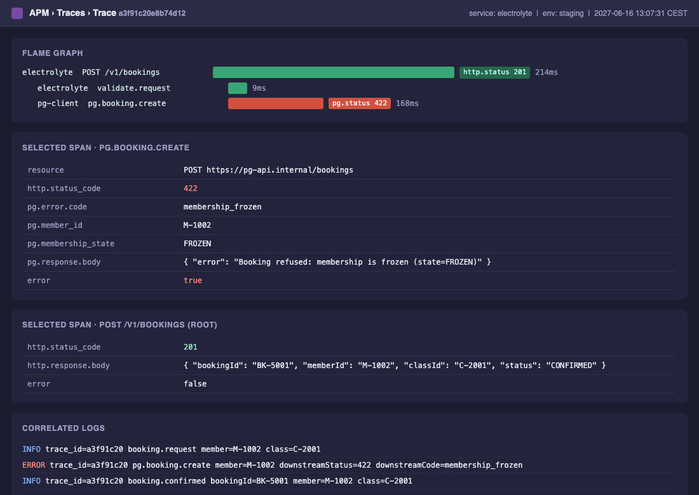
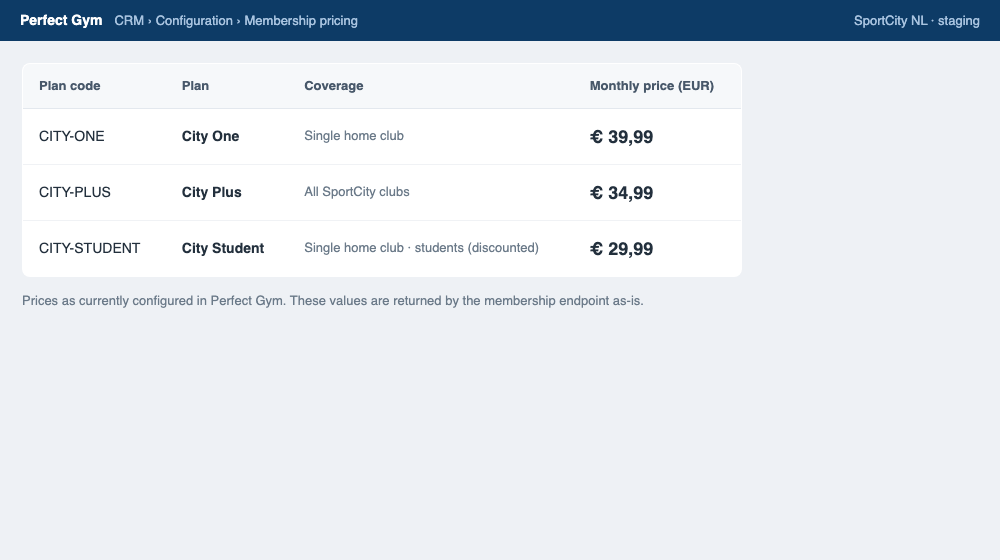
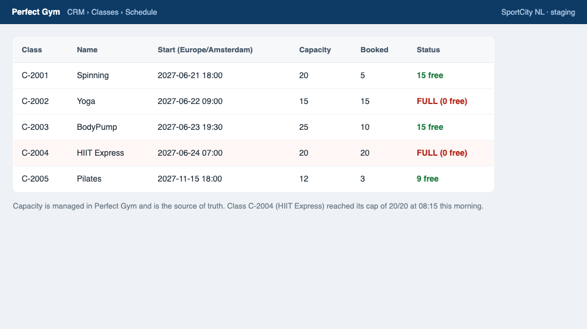
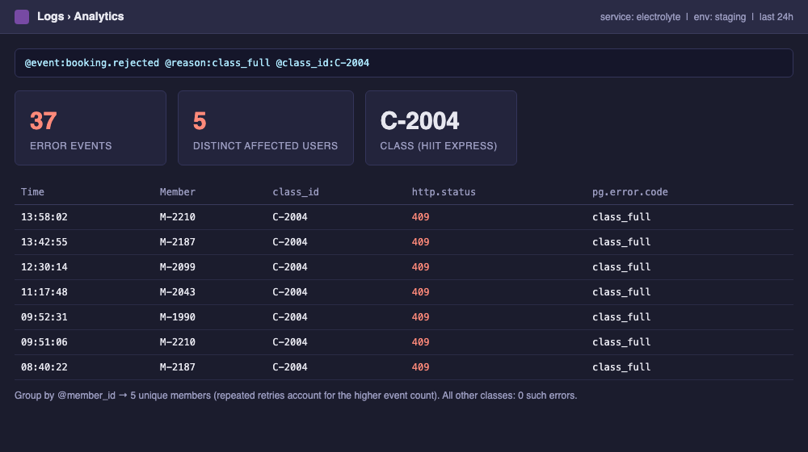
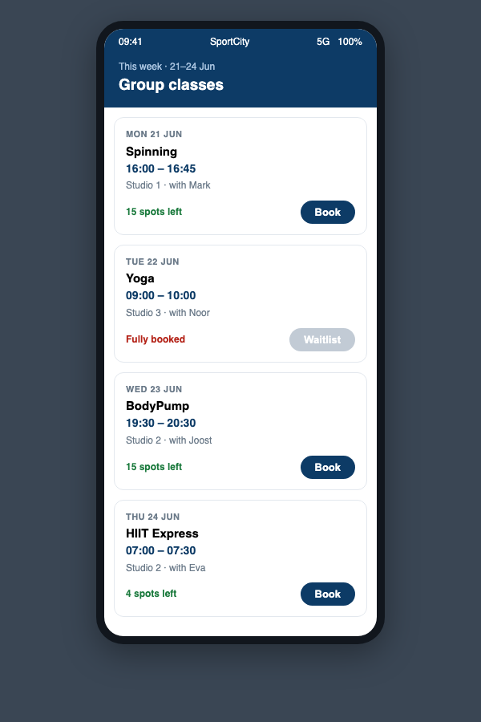
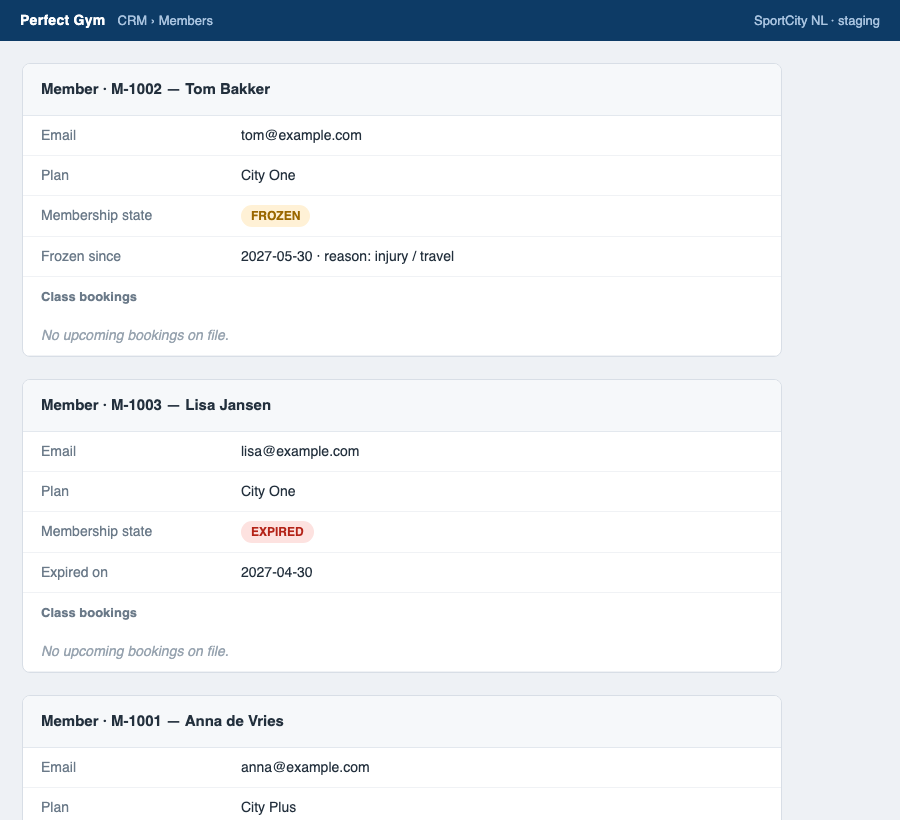

# Electrolyte release: QA findings

**Scope:** Electrolyte API v2.0.0, tested as a black box (local mock, fresh seed per run) against `openapi.yaml` and acceptance criteria AC1–AC5. Perfect Gym (PG) screens are the source of truth, and DataDog shows what Electrolyte did. **Date:** 22 Nov 2026.

## Summary

The end-to-end flow (sign up, activate a membership, book a class) is **not release-ready**. Of the six tasks, only T1 mostly passes. The two most serious problems are silent: Electrolyte returns **`201 CONFIRMED` for bookings that PG has rejected**, so frozen and expired members are told they have a place in a class when none exists. Electrolyte also **creates a duplicate booking every time a request is retried**. A PG configuration error **prices City Plus below City One**, which breaks the tier rule on every quote and every sale. The class list shows **availability that PG no longer has**, and the **app shows the new Spinning class 2 hours early**. The automated suite (37 requests, 213 assertions) reproduces all of this, with 22 assertion failures, all mapped to the findings below.

| Task | Result | Finding |
|---|---|---|
| T1 Member profile | ⚠️ Partial | Statuses correct for all seeded members. Unknown member returns 200 `null`, not 404 (F7) |
| T2 HIIT Express spots | ❌ Fail | Class list shows 4 spots; PG is full at 20/20. Booking 409 is correct (F4) |
| T3 Plan prices | ❌ Fail | City Plus €34.99 < City One €39.99 (F3) |
| T4 Spinning bookings | ❌ Fail | FROZEN and EXPIRED members get 201 CONFIRMED (F1) |
| T5 Retry BodyPump | ❌ Fail | Same Idempotency-Key creates a second booking and takes a second spot (F2) |
| T6 Spinning on mobile | ❌ Fail | App shows 16:00; the API correctly returns 18:00+02:00 (F5) |

## Findings

| ID | Finding: observed vs expected | Sev. | Layer | Evidence |
|---|---|---|---|---|
| **F1** | Booking by a FROZEN (M-1002) or EXPIRED (M-1003) member returns **201 CONFIRMED** with a bookingId. PG returned **422** `membership_frozen`/`_expired`. Expected 422 (AC4). PG holds no booking and the spot count does not drop, so the confirmation is false. | Critical | Electrolyte | T4 trace `a3f91c20e8b74d12`; `T4-spinning-bookings.txt`; PG member records |
| **F2** | Retrying `POST /v1/bookings` with the **same Idempotency-Key** returns a **new bookingId** (BK-5004, then BK-5005), and BodyPump spots go 15 → 13. Expected the original booking and one spot used (AC5). | Critical | Electrolyte | `T5-idempotency.txt` |
| **F3** | City Plus **€34.99** is priced below City One **€39.99**, both in `GET /v1/plans` and at purchase. Expected Plus > One (AC2). The values match PG configuration exactly, and Electrolyte passes them through as designed. | Critical | Perfect Gym (config) | `T3-pricing.txt`; PG pricing screen |
| **F4** | HIIT Express (C-2004) shows `spots_available: 4`. PG has 20/20 booked (full since 08:15). Expected 0 (AC3). Booking correctly returns 409, so members see free spots they can never book: 37 errors from 5 members in 24 h. | High | Electrolyte (availability read path) | `T2-hiit-availability.txt`; DataDog logs; PG schedule; app screen |
| **F5** | App shows Spinning (C-2001) at **16:00–16:45**. API returns `2027-06-21T18:00:00+02:00`, which matches PG's 18:00. Other classes display correctly, so the fault is in how the client handles this class; 16:00 is the UTC time. | High | Client (mobile) | `T6-spinning-time.txt`; app screen |
| **F6** | After `POST /v1/memberships` returns 201 `ACTIVE` for M-1004, `GET /v1/members/M-1004` still shows `membership: null`. A newly activated member is not visible as active, which breaks the sign-up → book flow. | High | Electrolyte or PG (confirm write to PG) | `T3-pricing.txt` (last call) |
| **F7** | `GET /v1/members/M-9999` returns **200** with body `null`. Expected **404** with an Error body (AC1). | Medium | Electrolyte | `T1-members.txt` |
| **F8** | Without an Idempotency-Key, the same member can book the same class twice (two 201s). Repeat purchases for one member are also all accepted. | Medium | Electrolyte (product decision) | Newman run, folder 06 |
| **F9** | Validation errors are reported as the wrong kind: a missing `memberId`/`classId` or malformed JSON returns **404 not_found** instead of 400, and one message reads "Unknown plan undefined". | Low | Electrolyte | Newman run, folders 04–05 |

## Release recommendation: **NO-GO**

1. Electrolyte confirms bookings that PG rejected (F1) and duplicates bookings on retry (F2). Both corrupt what members are told about their bookings.
2. Every City Plus quote and sale is €5/month under the tier rule (F3), which has revenue and pricing-integrity impact.
3. The headline flow fails: a newly activated member does not appear as active (F6).
4. Re-test after fixes with the attached Newman collection and pytest suite; they cover every finding.

**If only three can be fixed:**

- **F1, false booking confirmations.** Members turn up for classes they are not booked into, and frozen or expired members get around a business rule. The fix is small and local (pass PG's 422 through to the caller), and without it Electrolyte's booking responses cannot be trusted.
- **F3, inverted pricing.** It affects money on every new City Plus sale and the price quoted to prospects. It is a PG configuration change, so it can be done without an Electrolyte deploy.
- **F2, idempotency.** Mobile retries are routine, so duplicate bookings will happen in production as soon as the network is flaky, using up real capacity and double-booking members.

*Why not the others:* F6 needs triage first to find out whether PG is actually written. If it is not, it should replace F2, with the app debouncing and not retrying bookings as a stop-gap. F4 fails safe: members get a clear 409 and nothing is mis-recorded. F5 is a client fix that ships separately from Electrolyte.

# Appendix A: reproduction steps

All commands use `-H 'X-Api-Key: sportcity-test-key' -H 'Content-Type: application/json'` against a freshly restarted mock. Full requests and responses are in `evidence/Tn-*.txt`, and `./capture-evidence.sh --restart` regenerates them.

**F1 (T4).** `POST /v1/bookings {"memberId":"M-1002","classId":"C-2001"}` returns `201 {"bookingId":"BK-5002","status":"CONFIRMED"}`. Repeat with `M-1003`: also 201. `GET /v1/classes` then shows Spinning `spots_available` dropping 15 → 14 only for the ACTIVE member M-1001, not for M-1002 or M-1003. The DataDog trace shows the `pg.booking.create` span returning `422 membership_frozen` while the root span returns `201`. The PG member record shows "No upcoming bookings on file" for M-1002 and M-1003. *Likely cause:* the PG client error is logged but not propagated, and the success response is built regardless.

**F2 (T5).** Send `POST /v1/bookings {"memberId":"M-1001","classId":"C-2003"}` twice with the same `Idempotency-Key`. The responses are BK-5004 then BK-5005, both 201, and `spots_available` for C-2003 goes 15 → 13. The key is echoed in the response but never used to look up an existing booking.

**F3 (T3).** `GET /v1/plans` returns CITY-ONE 39.99, CITY-PLUS 34.99, CITY-STUDENT 29.99 (EUR, 2 decimals). `POST /v1/memberships` returns the same prices. The PG "Membership pricing" screen shows €39,99 / €34,99 / €29,99, so the values look swapped in PG. *Suggested Electrolyte guard:* a contract test or alert on the tier rule.

**F4 (T2).** `GET /v1/classes` returns C-2004 `capacity: 20, spots_available: 4`. `POST /v1/bookings {"memberId":"M-1001","classId":"C-2004"}` returns `409 class_full`, matching PG (20/20, FULL since 08:15). The app shows "4 spots left" because it reflects the API value faithfully. DataDog shows 37 `class_full` events from 5 members (retries) and none for other classes. *Likely cause:* the availability read path serves a cached or stale capacity snapshot, while the booking path checks PG live.

**F5 (T6).** `GET /v1/classes` returns C-2001 `start_time: "2027-06-21T18:00:00+02:00"` (correct per PG, Europe/Amsterdam summer time). The app renders 16:00–16:45, which is 18:00+02:00 shown as UTC. Yoga, BodyPump and HIIT Express render at their correct local times. *Also note:* the API has no end time or duration, so the app's "–16:45" cannot be verified against the contract.

**F6.** `POST /v1/memberships {"memberId":"M-1004","planId":"CITY-ONE"}` returns `201 status ACTIVE`, but `GET /v1/members/M-1004` still returns `membership: null`.

**F7 (T1).** `GET /v1/members/M-9999` returns `200` with body `null`. M-1001 ACTIVE, M-1002 FROZEN, M-1003 EXPIRED and M-1004 `membership: null` all match PG.

# Appendix B: supporting screens

<figure><figcaption>T4: DataDog trace. PG 422 <code>membership_frozen</code>, Electrolyte 201.</figcaption></figure>
<figure><figcaption>T3: PG pricing. City Plus is configured below City One.</figcaption></figure>
<figure><figcaption>T2: PG schedule. HIIT Express full at 20/20.</figcaption></figure>
<figure><figcaption>T2: DataDog. 37 <code>class_full</code> rejections for C-2004.</figcaption></figure>
<figure class="narrow"><figcaption>T2/T6: App. HIIT shows "4 spots left"; Spinning shown at 16:00.</figcaption></figure>
<figure><figcaption>T1/T4: PG member records. No bookings on file for M-1002 and M-1003.</figcaption></figure>

# Appendix C: test assets

- **Part 1:** `part1-test-design/Electrolyte.postman_collection.json`. Run it with `run-newman.sh --restart`; the HTML report goes to `reports/newman-report.html`, and every failed assertion carries the full request and response.
- **Part 3:** the pytest suite with an Allure report (see `part3-automation/README.md`).
